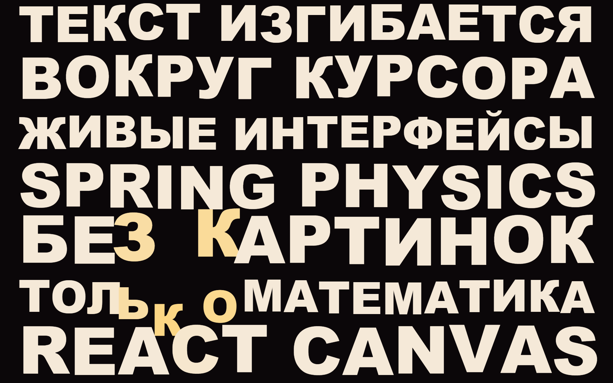
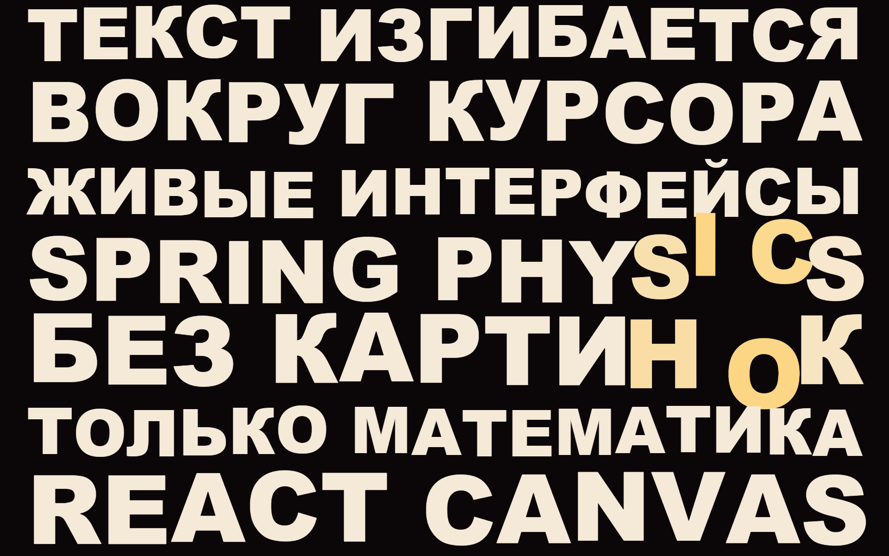

# Text Warp

**Резиновая типографика: текст изгибается вокруг курсора / Elastic typography that bends around your cursor.**

Экран набран крупными строками, каждый символ живёт на собственной пружине:
курсор расталкивает буквы, они наклоняются по инерции и возвращаются на место
с упругим перелётом. Клик отправляет ударную волну по всему тексту. Пока мышь
не двигали, по странице гуляет «призрак» курсора — страница дышит сама.

Никаких библиотек анимации и шейдеров: Canvas 2D + пружинная физика,
несколько сотен строк на React.

**Live demo (GitHub Pages): https://snowxdxaxd.github.io/text-warp/**

| Призрак курсора изгибает текст | Ударная волна от клика |
| --- | --- |
|  |  |

## Как устроено

- Строки раскладываются по экрану и масштабируются так, чтобы каждая занимала
  всю ширину — получается плотная типографская стена.
- Для каждого символа считается «домашняя» точка; к ней он привязан пружиной
  (`v += (target - x) * stiffness; v *= damping`), откуда и берётся упругий
  изгиб с перелётом.
- Курсор в радиусе отталкивает домашние точки (квадратичное затухание силы),
  вблизи символы перекрашиваются в акцентный цвет.
- Клик создаёт расходящееся кольцо: символы на фронте волны получают
  импульс от центра.
- Буквы наклоняются пропорционально горизонтальной скорости — текст
  «перетекает», а не просто разлетается.
- Всё адаптировано под devicePixelRatio и ресайз окна; на тач-устройствах
  работает проводник пальцем, в покое — «призрак».

## Запуск

```bash
npm ci
npm run dev      # http://localhost:5174
npm run build    # прод-сборка в dist/
```

## Настройки

Константы в шапке `src/warp/TextWarp.jsx`: `PHRASES` (текст строк),
`STIFFNESS`/`DAMPING` (жёсткость и затухание пружин), `REPEL` (сила
отталкивания), `WAVE_SPEED`/`WAVE_KICK` (ударная волна), `BASE`/`ACCENT`
(цвета).
